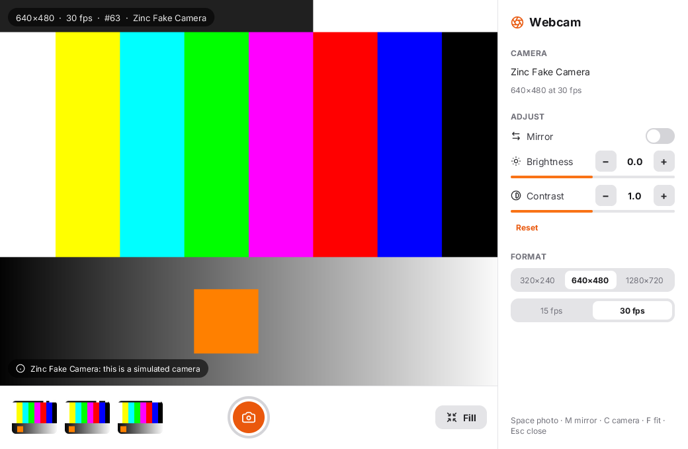
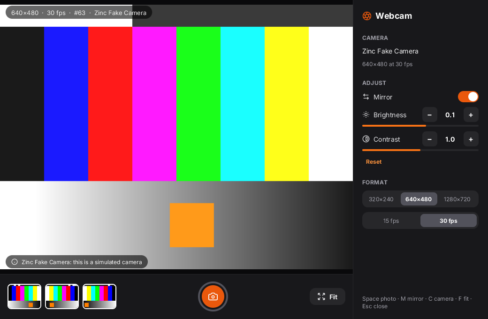
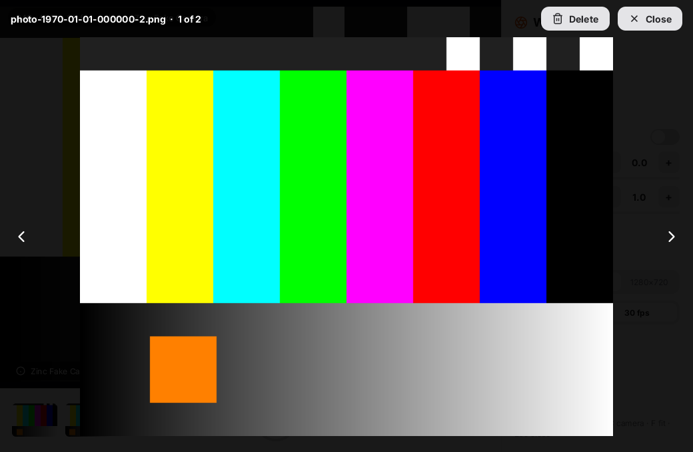
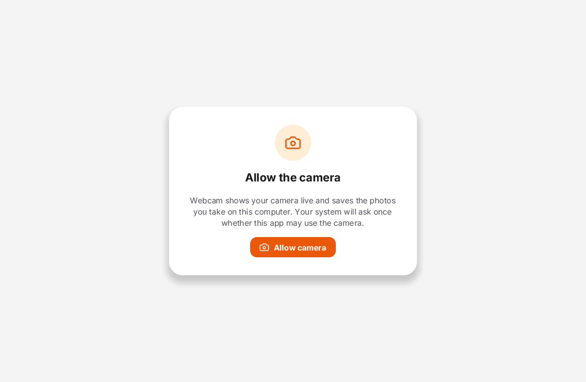
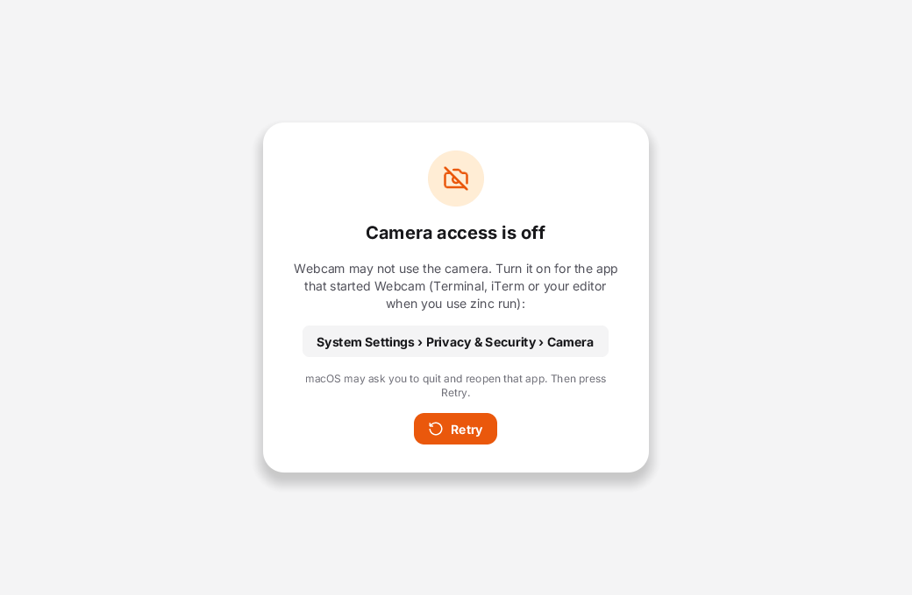
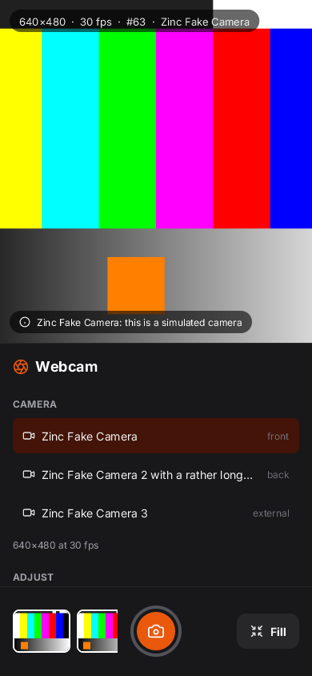

# Webcam

A small camera app on [`zinc:camera`](../../docs/plugins/camera.md), written in the React model (`zinc:ui/react`, `className` and
capitalised components, light and dark from the system): a live preview, a camera picker, a shutter that saves PNG photos, a strip of the
last shots with a viewer, adjustments, the capture format, and the screens for the camera permission.



| | |
|---|---|
|  |  |
|  |  |
|  | |

## Run it

```sh
build/zinc run examples/webcam                         # your webcam (macOS: AVFoundation; Linux and the Pi: V4L2)
ZINC_FAKE_CAMERA=1 build/zinc run examples/webcam      # the simulated "Zinc Fake Camera" instead
build/zinc run examples/webcam/src/web.tsx             # the same camera through navigator.mediaDevices.getUserMedia
```

**The first run on a Mac** shows "Allow the camera". Press **Allow camera**: macOS asks once whether the app that started Zinc (Terminal,
iTerm, or your editor's terminal) may use the camera. Say OK and the preview starts. The answer is kept in **System Settings > Privacy &
Security > Camera**; if you said no, the app shows that path and a **Retry** button (macOS may ask you to quit and reopen the terminal
first). An exported app (`zinc export --target macos`) asks in its own name: `"permissions": ["camera"]` in `zinc.json` puts the usage
string and the entitlement into the `.app`.

On Linux and the Raspberry Pi there is no question; your user needs the `video` group (`sudo usermod -aG video $USER`, then log out and
in again): without it the app shows that command. On Android and iOS the system asks when you press **Allow camera**; the text of the
question is `"permissionStrings"` in `zinc.json`. Without any camera, the app opens the fake camera and says "this is a simulated camera".

`zinc.json` has an `app` id, so `zinc run` on a Mac starts it from a small app bundle whose Info.plist asks for the camera properly: an
iPhone used as a webcam (Continuity Camera) is listed without AVFoundation's warning.

## The layout

The window decides the layout, at any size and as it is resized:

| | |
|---|---|
| Landscape (a desktop window, a tablet or a phone on its side) | the picture with the shutter bar under it, the settings in a column on the right that scrolls when the window is short |
| Portrait (a phone) | the picture on top, the settings in a scrolling sheet under it, the shutter at the bottom where a thumb reaches it, inside the safe areas |
| Touch screen | larger buttons, steps and rows; no keyboard hints |

Long camera names end with "…" and keep their position (front, back, external) visible; the HUD stays on the picture, never on the bars.

## Speed

Nothing slow runs where it would freeze the window. The window shows first, then the camera list and the saved photos load (one photo a
frame). On macOS a camera starts and stops off the main thread, and a new size or rate reuses the running camera instead of stopping and
starting it; clicking through sizes or cameras quickly ends on the last one asked. The preview is drawn only when the camera delivers a
frame, so the app sleeps in between (30 previews a second at 30 fps, none of them re-rendering the React tree). A photo appears in the
strip at once (a copy of the frame) and its PNG is encoded on another thread, then written.

## What it does

| | |
|---|---|
| Preview | the camera's frames fill the window, **Fit** (all of it, bars around) or **Fill** (cropped to the window) |
| HUD | size, measured frames per second, frame index and camera name, over the preview |
| Camera | a list to pick from when there are several (front, back, external) |
| Shutter | a short white flash; the frame on screen, adjustments included, is saved as `photo-YYYY-MM-DD-HHMMSS.png` |
| Photos | the last shots in a strip; a click opens the viewer: previous, next, **Delete**, **Close** |
| Adjust | mirror, brightness (-1..1) and contrast (0..2) in steps of 0.1, **Reset** (the plugin's `setOption`) |
| Format | 320×240, 640×480 or 1280×720, at 15 or 30 fps (the camera is opened again) |

Keys: **Space** takes a photo, **M** mirrors, **C** switches to the next camera, **F** fits or fills, **← →** browse the viewer,
**Esc** closes the viewer, then the app.

The photos go to `webcam/Photos/` next to the app's storage: `~/.zinc/webcam/Photos` (or under `ZINC_HOME`, or beside the
`ZINC_STORAGE` file when that is set). Reopening the app shows the last twelve.

## Files

| File | Role |
|---|---|
| `src/main.tsx` | the keyboard shortcuts, `render`, a new layout when the window changes size |
| `src/App.tsx` | the screens: permission cards, the preview canvas and the HUD, the settings (side column or sheet), the viewer |
| `src/session.ts` | everything that talks to the camera and the disk: permission, camera list, open/close, options, fps, photos |
| `src/web.tsx` | the getUserMedia page: `import 'zinc:camera'` then `navigator.mediaDevices.getUserMedia({ video: true })` |

## Tests and screenshots

`tests/t1/webcam_demo.sh` drives the app headless on the fake camera (`ZINC_FAKE_CAMERA=1 ZINC_DETERMINISTIC=1`) with scripted
input and checks a frame hash per state and the log of each session (`WEBCAM_LOG=1`). A test never asks the system for the camera:
the permission screens are shown with `WEBCAM_DEMO_PERMISSION=undetermined|denied|granted`, which only replaces the first reading of
the status (tests and screenshots; pressing **Allow camera** or **Retry** still asks the plugin, which grants the fake camera).
The size classes have their own frames: 1440×900, 800×600 with four fake cameras (`ZINC_FAKE_CAMERA=4`) and a 390×844 phone with touch
targets (`ZINC_POINTER=touch`). Each second of the log says how many previews were drawn and how many renders ran, and the test fails
when the app draws faster than the camera or re-renders for a frame.
The screenshots were taken the same way, at 1040×680 (`ZINC_SHOT=…png`, `ZINC_SCHEME=dark` for the dark one).

`getUserMedia` does not ask for the camera the way a browser would: on a Mac where access was never given, `src/web.tsx` fails with
`NotAllowedError` until the main app's **Allow camera** has asked once.
