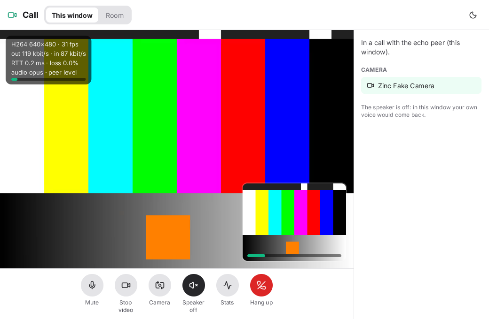
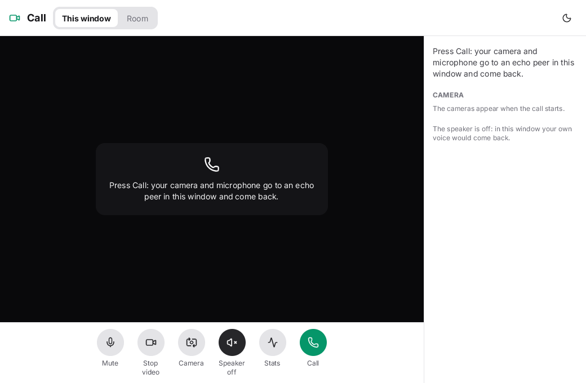
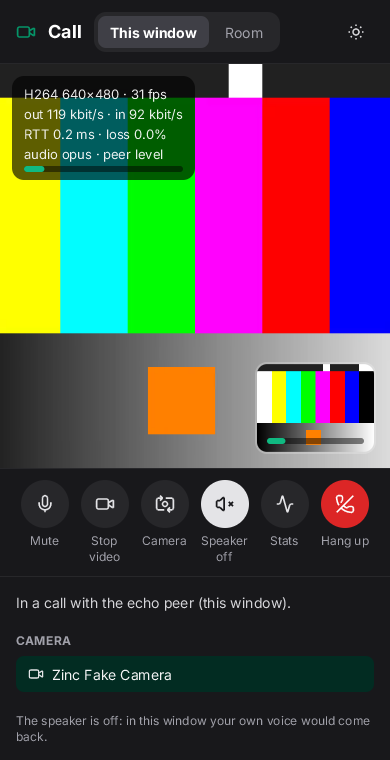

# Call

A video call on [`zinc:webrtc`](../../docs/plugins/webrtc.md) with audio and video tracks, [`zinc:camera`](../../docs/plugins/camera.md),
[`zinc:microphone`](../../docs/plugins/microphone.md) and [`zinc:audio`](../../docs/plugins/audio.md), written in the React model
(`zinc:ui/react`, light and dark): the other side's video with your preview in a corner, mute with a level meter, video on and off, a camera
picker, the speaker, a stats overlay (codec, size, frame rate, bit rates, round-trip time, packet loss) and hang up. The layout fits a wide
window and a phone held upright.



| | |
|---|---|
|  |  |

## Run it

```sh
build/zinc run examples/webrtc-call                                          # your camera and microphone
ZINC_FAKE_CAMERA=1 ZINC_FAKE_MICROPHONE=1 build/zinc run examples/webrtc-call  # the simulated ones instead
```

Press **Call** (or Enter). The first time, macOS asks whether the app that started Zinc (Terminal, iTerm, your editor) may use the camera
and the microphone; the answers are kept in System Settings > Privacy & Security.

- **This window** (the default): your camera and microphone go to an echo peer in the same program, which sends what it receives straight
  back. The big picture went through the encoder, the network stack and the decoder twice; nothing leaves the machine.
- **Room**: one person per copy of the app, on two machines of a LAN. Start webrtc-chat's signalling server on one of them
  (`build/zinc run examples/webrtc-chat/signal-server.ts`), put its address and the same room name in both apps, press Call.
- **Invite link**: paste a link from the [call server](server/README.md), or set `CALL_LINK` before starting the app. It joins Galène directly,
  alongside its browser client, with VP8 video and Opus audio. The invite field hides its token; anyone with that link can join until it expires or is revoked.

```sh
CALL_LINK='https://call.example.org/join.html#friends/INVITE_TOKEN' build/zinc run examples/webrtc-call
```

Galène group links (`https://call.example.org/group/friends/?token=…`) and `zinc-call://` app links work too. Plain HTTP is accepted only on
localhost. The name field is used for invitations that do not already specify a name. Press **Call** to join, and **Hang up** to leave.
Each remote camera or screen has its own tile. **Speaker video** requests its full video layer and makes the other visible tiles thumbnails;
**Hide video** requests audio only, and **Show video** resumes the thumbnail. The tile's stats show actual received video/audio bytes.
**Share screen** publishes a separate stream while your camera continues. The microphone, video, speaker and low-data controls apply to the call.

The client answers pings, sends one every 10 seconds and reconnects a lost signalling connection with backoff. Reconnecting signalling joins
the group again. **Media recovery without rejoining is not implemented yet:** the current libjuice backend cannot restart ICE; an ICE failure
shows that limitation. A working libnice experiment exists in the task notes, but it has not replaced the portable native backend.

A call between this Mac and an iPhone in Zinc Go (paired with `zinc device pair`), on the same Wi-Fi:

```sh
build/zinc run examples/webrtc-chat/signal-server.ts                     # terminal 1: the signalling server, port 8787
CALL_MODE=room build/zinc run examples/webrtc-call                        # terminal 2: the Mac's side (server ws://localhost:8787)
build/zinc device deploy examples/webrtc-call --env CALL_MODE=room --env CALL_SIGNAL=ws://<the Mac's LAN address>:8787
```

Keep the room name `zinc` on both (or type another one in both), press Call on each side. The address can also be typed in the phone's
**Signalling server** field. `ipconfig getifaddr en0` prints the Mac's address.

Keys: **M** mutes, **V** stops the video, **C** picks the next camera, **S** shows or hides the stats, **L** the ultra low data mode, **Esc** hangs up, then quits.

The speaker is off at first: in this window your own voice would come back through it. The microphone uses echo cancellation, noise
suppression and gain control; a headset is still recommended for room and invite calls.

## How it works

- `call.ts` opens the devices with `navigator.mediaDevices.getUserMedia`, adds their tracks with `addTrack`, and draws nothing. The peer's
  tracks arrive in `ontrack`: the video track's `camera` is a `RemoteVideo` (an image the screen draws, like a camera's), the audio
  track's `microphone` a `RemoteAudio` whose blocks of samples go to an `audio.stream()`.
- Mute sets `track.enabled = false` (the peer gets silence or black frames); the camera picker opens another camera and calls
  `sender.replaceTrack`, so no new negotiation is needed.
- The overlay reads `pc.getStats()` once a second: `outbound-rtp` and `inbound-rtp` bytes give the bit rates, `inbound-rtp` the size and
  frame rate, `remote-inbound-rtp` the round-trip time.
- The side panel is zinc:ui/kit's `CallStats`, fed by zinc:webrtc's `CallQuality`: a good / fair / poor score with its MOS, the loss, the
  round trip and the bit rates with sparklines. Its **Ultra low data** switch (key **L**) calls `setLowDataMode`: Opus at 10 kbit/s with
  DTX and FEC and a 160x120 video at 5 fps, about 23 kbit/s out in all instead of about 120; it switches on by itself after 5 poor seconds.
- Codecs: H.264 in hardware where the machine has it (VideoToolbox on macOS), VP8 otherwise, Opus for the audio.
- `galene.ts` owns protocol v2 discovery, token join, membership, stream negotiation, tile requests, ping, reconnect and cleanup.
  `GaleneGrid.tsx` and `GaleneTile.tsx` show its remote streams with Quiet kit controls.

Test hooks: `CALL_DEMO=1` runs a scripted session (call, mute, video off, the camera again, hang up, quit), `CALL_LOG=1` prints what happens
(`tests/t1/webrtc_call.sh`), `CALL_DEMO=shot` waits for the picture and the numbers then quits (the screenshots), `CALL_MODE=room`
starts on the room tab, `CALL_SIGNAL=ws://host:port` names the signalling server, `ZINC_SCHEME=dark` the dark scheme.

## Self-hosting

The [call server](server/README.md) configures and supervises the pinned Galène server and creates expiring browser invitations with QR codes.
