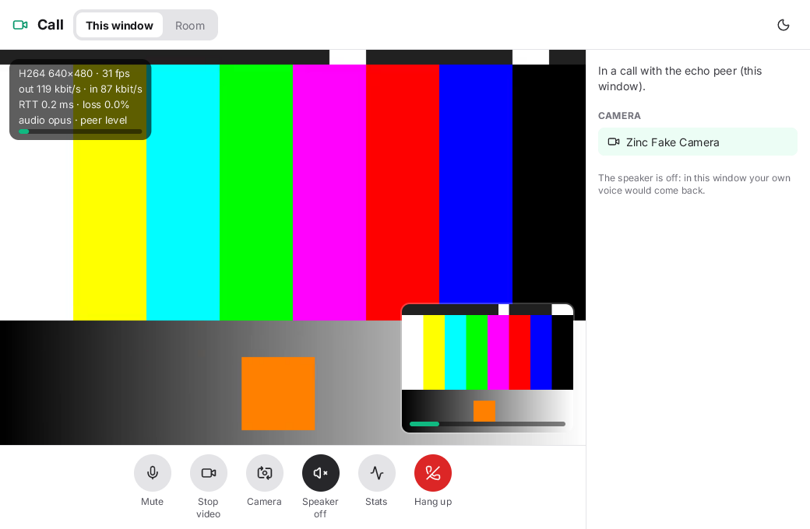
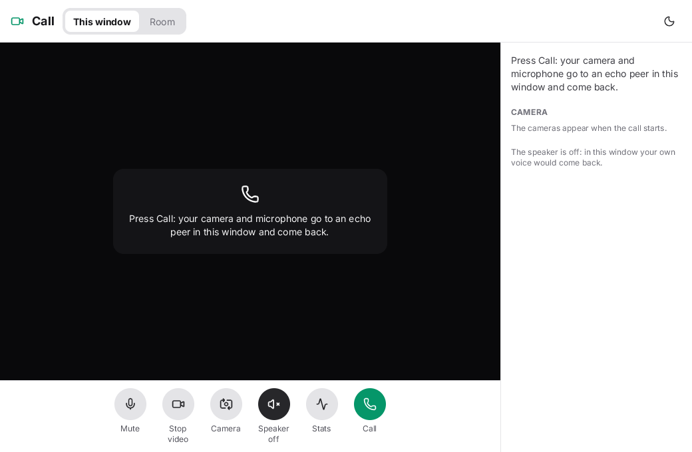
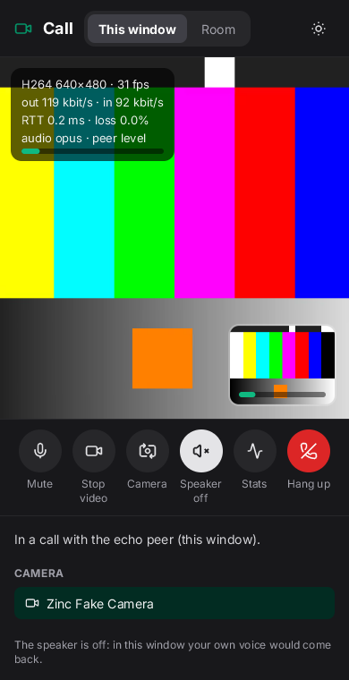

# Call

A video call on [`zinc:webrtc`](../../docs/plugins/webrtc.md) with audio and video tracks, [`zinc:camera`](../../docs/plugins/camera.md),
[`zinc:microphone`](../../docs/plugins/microphone.md) and [`zinc:audio`](../../docs/plugins/audio.md), written in the React model
(`zinc:ui/react`, light and dark): the other side's video with your preview in a corner, mute with a level meter, video on and off, a camera
picker, the speaker, a stats overlay (codec, size, frame rate, bit rates, round-trip time, packet loss) and hang up. The layout fits a wide
window and a phone held upright.



| | |
|---|---|
|  |  |

## Run it

```sh
cd next
build/zinc run ../examples/webrtc-call                                          # your camera and microphone
ZINC_FAKE_CAMERA=1 ZINC_FAKE_MICROPHONE=1 build/zinc run ../examples/webrtc-call  # the simulated ones instead
```

Press **Call** (or Enter). The first time, macOS asks whether the app that started Zinc (Terminal, iTerm, your editor) may use the camera
and the microphone; the answers are kept in System Settings > Privacy & Security.

- **This window** (the default): your camera and microphone go to an echo peer in the same program, which sends what it receives straight
  back. The big picture went through the encoder, the network stack and the decoder twice; nothing leaves the machine.
- **Room**: one person per copy of the app, on two machines of a LAN. Start webrtc-chat's signalling server on one of them
  (`build/zinc run ../examples/webrtc-chat/signal-server.ts`), put its address and the same room name in both apps, press Call.

Keys: **M** mutes, **V** stops the video, **C** picks the next camera, **S** shows or hides the stats, **Esc** hangs up, then quits.

The speaker is off at first: in this window your own voice would come back through it. There is no echo cancellation yet, so use a
headset when you turn it on in a room call.

## How it works

- `call.ts` opens the devices with `navigator.mediaDevices.getUserMedia`, adds their tracks with `addTrack`, and draws nothing. The peer's
  tracks arrive in `ontrack`: the video track's `camera` is a `RemoteVideo` (an image the screen draws, like a camera's), the audio
  track's `microphone` a `RemoteAudio` whose blocks of samples go to an `audio.stream()`.
- Mute sets `track.enabled = false` (the peer gets silence or black frames); the camera picker opens another camera and calls
  `sender.replaceTrack`, so no new negotiation is needed.
- The overlay reads `pc.getStats()` once a second: `outbound-rtp` and `inbound-rtp` bytes give the bit rates, `inbound-rtp` the size and
  frame rate, `remote-inbound-rtp` the round-trip time.
- Codecs: H.264 in hardware where the machine has it (VideoToolbox on macOS), VP8 otherwise, Opus for the audio.

Test hooks: `CALL_DEMO=1` runs a scripted session (call, mute, video off, the camera again, hang up, quit), `CALL_LOG=1` prints what happens
(`next/tests/t1/webrtc_call.sh`), `CALL_DEMO=shot` waits for the picture and the numbers then quits (the screenshots), `CALL_MODE=room`
starts on the room tab, `CALL_SIGNAL=ws://host:port` names the signalling server, `ZINC_SCHEME=dark` the dark scheme.
