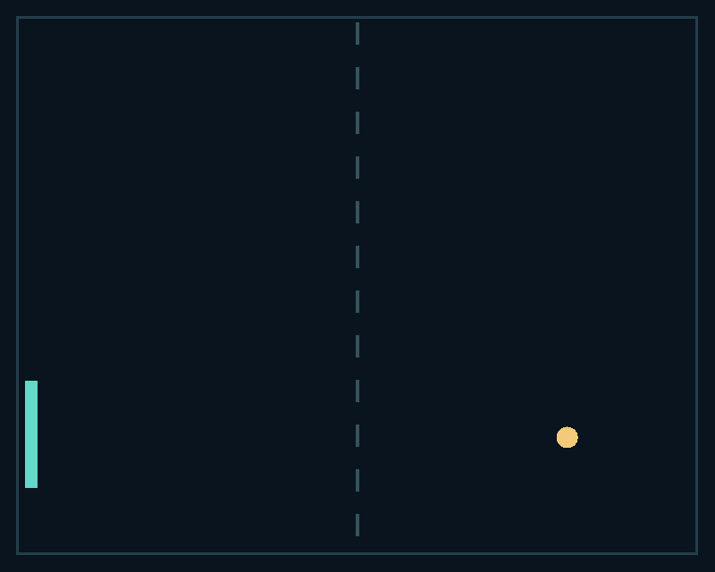

# Zinc Pocket Rally with experimental LibGodot



A Zinc-owned macOS AppKit window contains a Zinc TSX navigation panel and the
actual native view of a real Godot 4.6 game. This is runtime embedding: GDScript,
Godot's scene tree and renderer remain Godot. The game pack is not translated to
Zinc bytecode. One instance is supported; restart or multiple instances are not.

From the repository root on an Apple Silicon development Mac:

```sh
cmake -S . -B build -DCMAKE_BUILD_TYPE=Release
tools/build zn_app zinc
examples/zinc-libgodot/build.sh
examples/zinc-libgodot/package.sh
tests/run --only zinc_libgodot
ZINC_BACKGROUND=1 'examples/zinc-libgodot/build/Zinc Pocket Rally.app/Contents/MacOS/Launcher'
# Finite native-window proof, with actual GPU viewport PNG:
tests/run --tier demo --only zinc_libgodot_native
```

The first build fetches pinned official Godot 4.6 source (SHA256 verified), builds
its experimental shared library with SCons 4.9.1 in an isolated virtualenv/cache,
and fetches verified godot-cpp bindings. Nothing is installed globally. Set
`ZINC_GODOT_CACHE`, `LIBGODOT`, `GODOT_CPP`, `GODOT` or `BUILD` to reuse local tools
and the engine library build. The SCons job limit is conservatively two. Run this
large authoring-runtime build separately from other full engine builds.

`godot/` is a real editable Godot project. `game.gd` owns the paddle, ball, score
and pause state. Up/Down moves the paddle. Zinc's buttons pause, accelerate and
reset it. A bounded console-tap action vocabulary (`pause`, `faster`, `reset`)
invokes the game's explicit command method; its integer score snapshot updates
Zinc. `src/main.tsx` holds the Zinc navigation, and `native/host.mm` owns both
lifecycles and the desktop window. Unknown/oversized commands are ignored.

Godot's PCKPacker creates `rally.pck`; the runtime auto-loads the pack beside the
Zinc-owned executable. The package includes both runtimes and runs outside the
checkout without Godot editor or Zinc CLI installed. It retains Godot's runtime,
OpenGL-capable desktop requirements and larger footprint. The pinned minimal
library builds the genuine 2D runtime used here; 3D, Vulkan, Metal, Godot physics
and unused modules are disabled. This does not give a Godot game Zinc's console,
MCU, or old-device reach. The project explicitly selects Dummy physics because
movement/collision in this game is authored in GDScript.

The AppKit host attaches Godot's native `WINDOW_VIEW` to its game region and
returns it to Godot before destroying the engine. Zinc input is local to its
navigation view, while the game view receives native Godot input. The window is
fixed-size in this first integration. `ZINC_BACKGROUND=1` prevents activating it
during automated runs. The finite `--visual-test <PNG>` mode dispatches AppKit
mouse/key events, checks both attached views, saves the actual Godot viewport,
and closes the window through its delegate before destroying the engine. The host owns the loop,
with externally driven Godot iterations and Zinc ticks. Godot 4.6 has no supported
runtime restart promise, so the library intentionally stays loaded until process
exit after orderly instance destruction.

Executed: official source shared-library build; real game startup/ticks; actual
Zinc pointer clicks producing pause, resume, speed and reset commands; real Godot
score updates; clean shutdown; and bundled headless run from `/tmp`. Native view
attachment, actual OpenGL rendering, native AppKit keyboard movement, background
Zinc mouse clicks and window close/destruction also passed `--visual-test` on
Apple Silicon macOS. `.logs/libgodot-native.png` is the real Godot GPU viewport
readback, rather than a composite image or a capture of the whole desktop. No mobile/cross-platform, resize, restart,
multi-instance, footprint or performance claim is made. Distribution signing and
notarization are not provided. Upstream references:
[LibGodot FAQ](https://docs.godotengine.org/en/4.6/about/faq.html#is-it-possible-to-use-godot-as-a-library),
[GodotInstance API](https://docs.godotengine.org/en/4.6/classes/class_godotinstance.html).

Finite native performance probe (background window, no activation):

```sh
examples/zinc-libgodot/build/rally examples/zinc-libgodot/build/libgodot.dylib --bench-frames 330 --bench-workload active
```

Use `idle` for a paused scene/game. Frames include 30 warmup ticks; 31–360
are accepted. The host prints `workflow ready` once its native image/view is
available, then one `workflow bench json: ` record (schema 1) and exits cleanly.
The record preserves every steady tick interval and host work duration in
monotonic microseconds, plus startup readiness since host entry. Host work
measures wall time around native calls and image copy/presentation submission;
it does not measure GPU completion. Intervals count host ticks, including idle
ticks without a Zinc redraw, rather than claiming displayed-frame FPS. Run
`tests/run --tier demo --only native_host_bench` for the short lifecycle proof;
its timings are discarded. Measure on a quiet Mac and sample process memory
and CPU separately.
