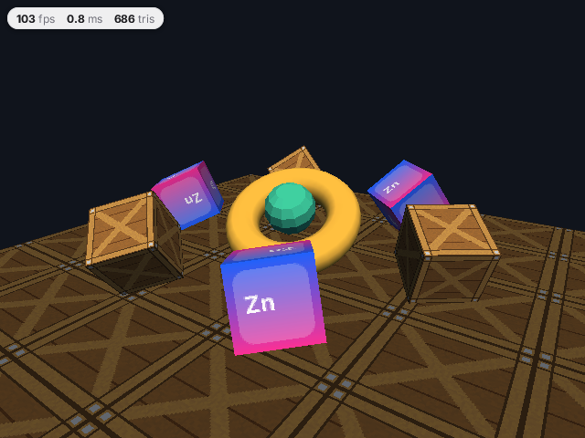

`zinc:3d` draws simple 3D scenes: a scene graph of nodes (a mesh and a material each), directional lights, a camera, and one
call, `render()`, that draws the view into a box of the window. The result is an ordinary image of the frame, so `zinc:gfx`
drawing and `zinc:ui` compose over it. The same program runs on the CPU rasterizer everywhere Zinc draws 2D, and on the GPU on
desktops that have one.



```ts
import { Scene, Camera, Node, Material, Light, cube, render } from 'zinc:3d';
```

## What is in it

- Primitives (`cube`, `sphere`, `plane`, `torus`), OBJ files (`loadObj`), `.zmesh` models made by the asset build (`loadModel`) and
  glTF files (`loadGltf`, from `zinc:3d/gltf`, a module of its own so a program that does not import it links no glTF code).
- `Material`: colour, texture, `Shading.Smooth`, `Shading.Flat` or `Shading.Unlit`, `Blend.Alpha` and `Blend.Add` for glows.
- Up to four directional `Light`s and `scene.ambient`; one `Camera` per view (a split screen is two cameras).
- `World`, for large static worlds (a city, a terrain) streamed in chunks.

## Where to go next

- [Your first 3D scene](01-first-scene.mdx): a cube and a torus that turn, in five steps.
- The full reference, with the options, the memory budgets, the model formats and the per-target table, is
  [docs/plugins/3d.md](https://github.com/Frulko/zinc/blob/main/docs/plugins/3d.md) in the repository; the code is
  [`plugins/3d/index.ts`](https://github.com/Frulko/zinc/blob/main/plugins/3d/index.ts).
- Runnable programs: [`examples/3d/cubes`](https://github.com/Frulko/zinc/tree/main/examples/3d/cubes) (the picture above),
  [`examples/3d/model`](https://github.com/Frulko/zinc/tree/main/examples/3d/model) and
  [`examples/3d/orbit`](https://github.com/Frulko/zinc/tree/main/examples/3d/orbit).
- Know three.js? [`three`](https://github.com/Frulko/zinc/tree/main/plugins/three/docs) puts its API on top of this plugin.
