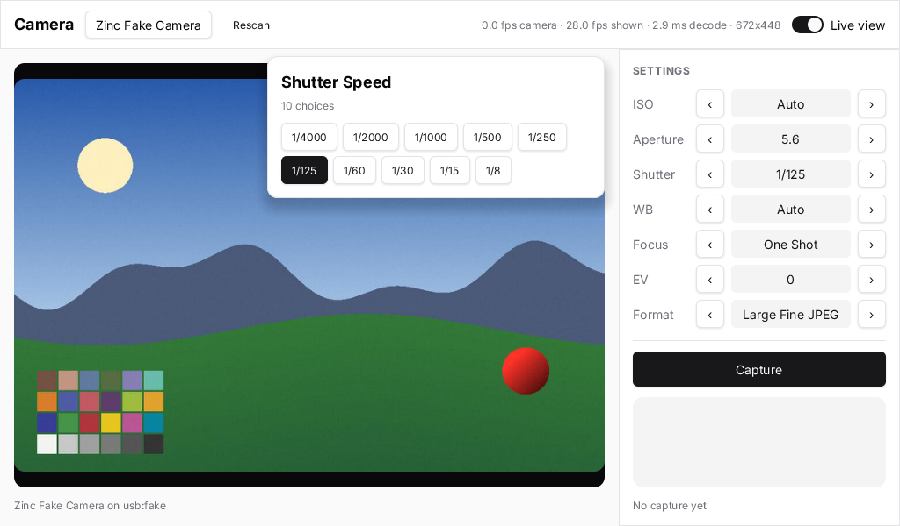

`zinc:camera` opens webcams, phone cameras and built-in cameras. The frames land in a runtime image of `zinc:gfx`, as the ones of
`zinc:video` do, so a program draws the camera like any picture. You can also take an RGBA snapshot or encode the frame as a PNG.



```ts
import { devices, requestPermission, Camera } from 'zinc:camera';
```

## The shape of the API

| | |
|---|---|
| `requestPermission()` | asks the person once (macOS) and resolves `'granted'`, `'denied'` or `'undetermined'` |
| `devices()` | the cameras, as `{ id, name, position }`; a fake camera when the machine has none, so a program still runs |
| `Camera.open(id, { width, height, fps }?)` | opens one (`''` is the first) and resolves once it runs |
| `cam.image`, `cam.onFrame(cb)` | the image with the newest frame, and a callback for each new one |
| `cam.setOption('mirror' \| 'brightness' \| 'contrast', value)` | adjustments done in software |
| `cam.snapshot()`, `cam.still()`, `cam.encodePng()` | RGBA bytes, a copy as an image, a PNG on a thread of its own |
| `cam.close()` | stops the camera |

The whole table, with the backends per target, the permission rules of `zinc.json` and the details of each call, is in the
[reference](https://github.com/Frulko/zinc/blob/main/docs/plugins/camera.md). For a DSLR over USB see `zinc:gphoto2`.

## Where to go next

- [Show a camera preview](01-show-a-preview.mdx).
- A complete app (picker, photos saved as PNG, adjustments, the permission screens):
  [`examples/webcam`](https://github.com/Frulko/zinc/tree/main/examples/webcam).
- The code: [`plugins/camera/index.ts`](https://github.com/Frulko/zinc/blob/main/plugins/camera/index.ts).
