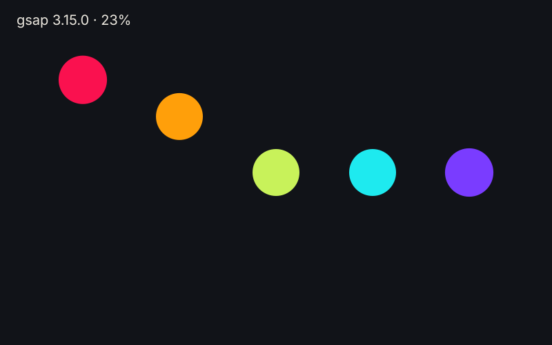

`import gsap from 'gsap'` gives a Zinc program GSAP's core API: tweens, timelines, eases, staggers, position parameters and labels. It
is written in typed Zinc, so it runs in the interpreter, as a native executable (`zinc build`) and on every target the language reaches,
with the same result.



```ts
import gsap from 'gsap';
```

## Two ways to use GSAP

| | |
|---|---|
| this plugin | the core API in typed Zinc: native builds, every target |
| the real library, [`examples/js-gsap`](https://github.com/Frulko/zinc/tree/main/examples/js-gsap) | GSAP whole, with ScrollTrigger, Flip, Draggable and the rest, on the QuickJS engine, in a JavaScript project (the picture above) |

Use the plugin when you write Zinc and want a native program; use the library when you port a JavaScript project that needs its plugins.

## Where to go next

- [Animate a box with a timeline](01-animate-a-box.mdx).
- The reference lists every tween option, ease and timeline method:
  [docs/plugins/gsap.md](https://github.com/Frulko/zinc/blob/main/docs/plugins/gsap.md).
- The code: [`plugins/gsap/index.ts`](https://github.com/Frulko/zinc/blob/main/plugins/gsap/index.ts).
