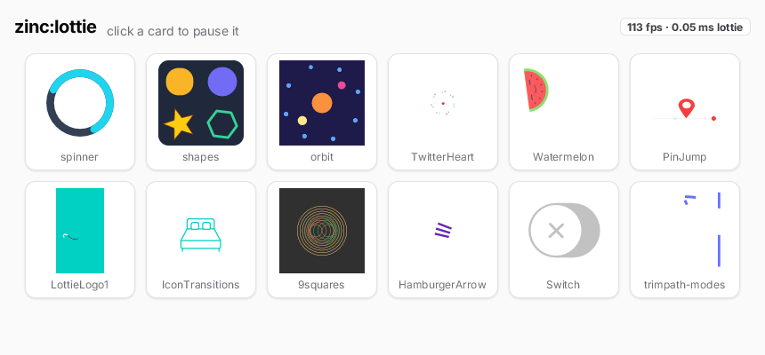

`zinc:lottie` plays Lottie animations, the JSON files exported from After Effects with Bodymovin or downloaded from LottieFiles. The
file is parsed once in C++ and every frame is drawn through Zinc's anti-aliased vector rasterizer, so no browser and no JavaScript
engine are involved.



```tsx
import { Lottie } from 'zinc:lottie';

<Lottie src="spinner.json" loop autoplay className="w-24 h-24" />
```

A `zinc:ui` program uses the `<Lottie>` component; a program that draws with `zinc:gfx` uses a `Player` (see the
[tutorial](01-play-an-animation.mdx)).

## What it draws

Shape layers (paths, rectangles, ellipses, stars, fills, strokes, trim paths, repeaters), solids, nulls and precomps, with keyframed
transforms and easing. Image and text layers, expressions, track mattes, merge paths and layer effects are skipped. The
[reference](https://github.com/Frulko/zinc/blob/main/docs/plugins/lottie.md) has the whole support table, the performance numbers and
the render-to-image mode for small looping icons.

## Where to go next

- [Play an animation](01-play-an-animation.mdx).
- The gallery above is [`examples/ui/lottie-gallery`](https://github.com/Frulko/zinc/tree/main/examples/ui/lottie-gallery): twelve
  files in a grid, with a frame-rate readout.
- The code: [`plugins/lottie/index.ts`](https://github.com/Frulko/zinc/blob/main/plugins/lottie/index.ts).
