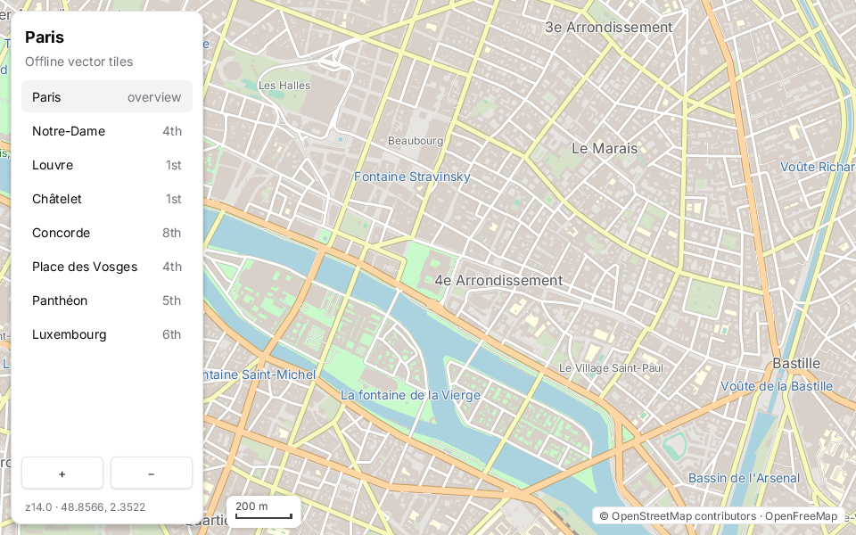

`zinc:map` draws interactive maps from vector tiles (Mapbox Vector Tiles in the OpenMapTiles schema, as served by OpenFreeMap and
MapTiler) with a subset of the MapLibre style language. It runs without a browser, a GPU or a JavaScript engine, and it was designed
for the Raspberry Pi 1 first, so it stays light on every machine.



```ts
import { MapView } from 'zinc:map';
```

## How it works, in three lines

- Each visible tile is drawn once into an image and kept in a cache; panning only moves cached images.
- Tiles come from a folder (`z/x/y.pbf`, for offline use) or from a URL, and the downloaded ones are cached on disk.
- Drag, wheel, pinch, double-click and the arrow keys are handled by `MapView.update`.

## Where to go next

- [Show a map](01-show-a-map.mdx), online and offline.
- The reference, with the style subset, the gestures, the targets and the benchmarks, is
  [docs/plugins/map.md](https://github.com/Frulko/zinc/blob/main/docs/plugins/map.md).
- The map above is [`examples/maps/explorer`](https://github.com/Frulko/zinc/tree/main/examples/maps/explorer): a place list, zoom
  buttons, a scale bar and the attribution.
- The code: [`plugins/map/index.ts`](https://github.com/Frulko/zinc/blob/main/plugins/map/index.ts).

<Callout type="note" title="Attribution">
  OpenStreetMap data asks for a credit: show "(c) OpenStreetMap contributors" somewhere on the map, as the explorer example does.
</Callout>
