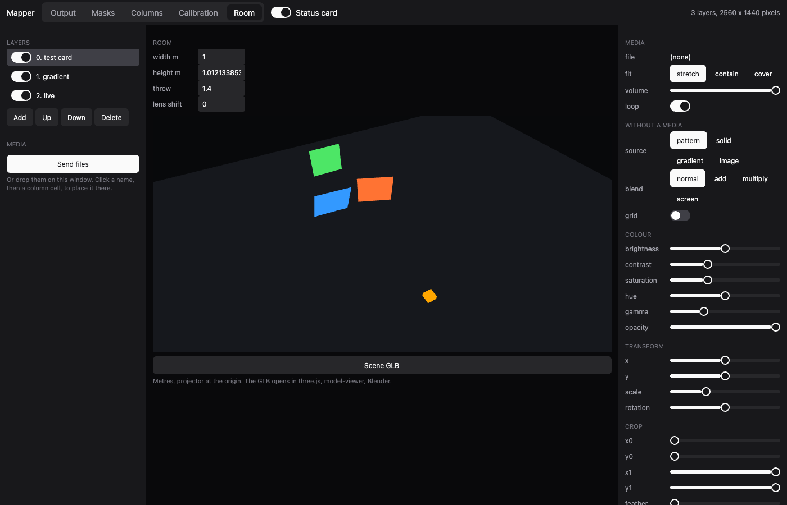

`zinc:mapping` is a video-mapping compositor. Layers of video, images or generated content are warped onto physical surfaces (corner
pin, mesh warp), masked, edge-blended and colour-corrected in shaders, and every parameter can be driven over OSC from a show
controller such as Chataigne or TouchOSC. It draws through [`display-gl`](https://github.com/Frulko/zinc/blob/main/docs/plugins/display-gl.md),
so the project needs `"display": "gl"` in `zinc.json`.



```ts
import * as mapping from 'zinc:mapping';
```

## The model in a paragraph

Everything is normalised. The output runs from (0, 0), top left, to (1, 1), bottom right, whatever the screen resolution. Each layer has
its own unit square, in which its masks, crop and edge blend live, so they follow the warp. A vertex goes surface, mesh warp, corner
pin, transform, output.

## Where to go next

- [Warp a layer onto a surface](01-warp-a-layer.mdx).
- The reference has the support matrix, the whole OSC address space and the save format:
  [docs/plugins/mapping.md](https://github.com/Frulko/zinc/blob/main/docs/plugins/mapping.md).
- The editor above is [`examples/video/mapper`](https://github.com/Frulko/zinc/tree/main/examples/video/mapper), with its Chataigne
  project.
- The code: [`plugins/mapping/index.ts`](https://github.com/Frulko/zinc/blob/main/plugins/mapping/index.ts).
