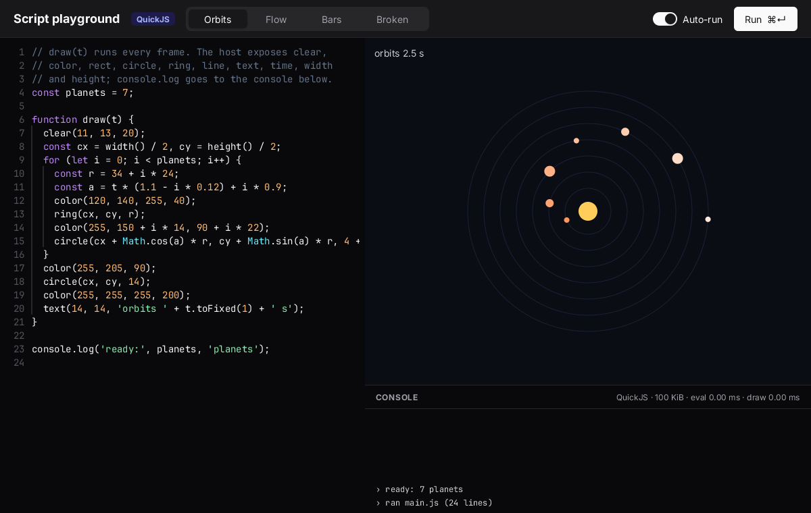

`zinc:script` runs JavaScript inside a Zinc program. A `Script` is a sandboxed context: it sees the language built-ins and the
functions you expose, and nothing else (no files, no network, no timers). Memory and time limits stop a runaway script without taking
the app down. Use it for mods, rules that change without a rebuild, and live-coded visuals.



```ts
import { Script } from 'zinc:script';
```

## What it offers

- `expose(name, fn)`: a typed Zinc function the script can call. Arguments are converted for you.
- `set` and `get`: copy data in and out. Values are copied at the boundary; nothing is shared.
- `eval`, `load` (an ES module) and `call`: run code and call what it defines.
- Errors come back as `ScriptError` with the script's file, line and stack.
- The engine is QuickJS-ng, compiled into the program (about 1 MB), on macOS, Linux, the Raspberry Pi and the reMarkable. It is not
  available on the ESP32, the PlayStations or the web.

## Where to go next

- [Drive a game with a script](01-drive-with-a-script.mdx).
- The reference (limits, value model, errors, async, the measurements):
  [docs/plugins/script.md](https://github.com/Frulko/zinc/blob/main/docs/plugins/script.md).
- The playground above is [`examples/scripting/playground`](https://github.com/Frulko/zinc/tree/main/examples/scripting/playground);
  [`breakout-mods`](https://github.com/Frulko/zinc/tree/main/examples/scripting/breakout-mods) is a game whose rules come from a script.
- The code: [`plugins/script/index.ts`](https://github.com/Frulko/zinc/blob/main/plugins/script/index.ts).
