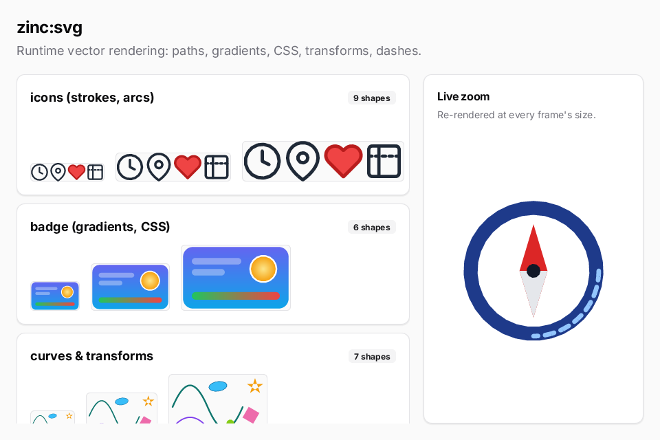

`zinc:svg` reads an SVG document once and draws it at any position and size through Zinc's anti-aliased vector rasterizer. Unlike
an image baked at build time, it stays sharp when you scale it, can change at run time, and supports strokes, arcs, `<use>`, CSS
rules and the usual transforms.



```ts
import { Svg } from 'zinc:svg';
```

`new Svg(text)` parses; check `ok` (and `error`); `width` and `height` are the intrinsic size; `draw(x, y, w, h, alpha)` paints it
inside a box and honours `preserveAspectRatio`; `dispose()` frees it.

## What is not drawn

`<text>`, `<image>`, clip paths, masks, patterns, filters, markers and SMIL animation are skipped, gradients are approximated (first
and last stop) and stroke joins and caps are round. The full support matrix is in the
[reference](https://github.com/Frulko/zinc/blob/main/docs/plugins/svg.md).

## Where to go next

- [Draw a scalable badge](01-draw-a-badge.mdx).
- The picture above is [`examples/maps/svg-gallery`](https://github.com/Frulko/zinc/tree/main/examples/maps/svg-gallery).
- The code: [`plugins/svg/index.ts`](https://github.com/Frulko/zinc/blob/main/plugins/svg/index.ts).
